# Channels

## Accessing Channel Settings

While a layer can also have channel settings, global channel settings can be accessed in the channel button above the layers list.

|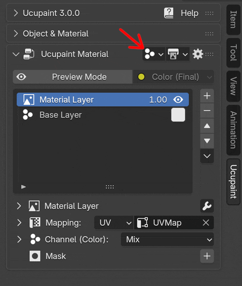|
|:--:|
|Clicking the channels button above the layers list will show the channel settings list|

Blender 2.7x has the channel settings below the layers list, but you can also use this UI in modern Blender versions (2.80+) if you enable `Use Non-Popup Channels and Bake Targets UI` in the preferences.

## Channel in Ucupaint

A channel in Ucupaint represents a pair consisting of an input and an output within the Ucupaint node. 

|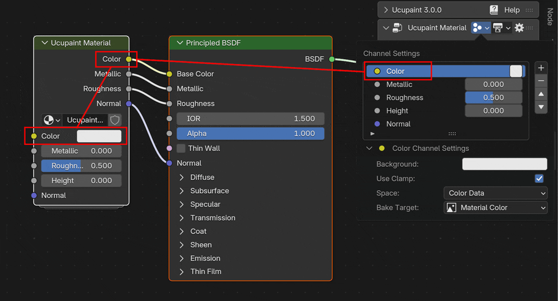|
|:--:|
|The Ucupaint channels input and output (I/O) on the actual node| {align=center}

Each channel has at least one input and one output, except for the `Height` channel, by default it doesn't have an output (read [Displacement Setup](#displacement-setup) for more info).

The base color or value of the channel is the default input of the node. They can be accessed through the channels list or on the base layer.

||
|:--:|
| Channel base values correspond to the node’s default input| {align=center}

All inputs and outputs can be freely connected, allowing the Ucupaint node to work with your custom node setups.
 
 
In the channels list panel, you can perform basic actions such as adding, moving up/down, or removing channels.

|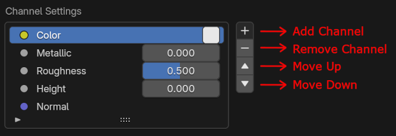|
|:--:|
|Channels list panel| {align=center}

<!--
!!! note
    You may need to learn how to create a layer before continuing on this page. Click [here](../01.02.layer/#creating-new-layer-quick-guide) to jump to the Layer page
-->

## Add New Channel

To add a new channel, use the `+` button next to the channel list. There are a few options to choose, which are `Custom`, `Alpha`, `Ambient Occlusion`, `Emission`, `Height`, `Normal`, and `Vector Displacement`.

<!-- TEMP OLD TEXT: You can create new channel by using the + button on the right of the channels list, it will gives you channel type options, which are RGB, Value, and Normal.
For demonstration, let's try to create new channel that connect to emission socket on the principled bsdf.
Now the popup appears, if you already decided to connect it to principled bsdf, you don't have to manually name the channel, just choose emission on the dropdown, it will automatically set the name of your channel, and if you click ok, it will also connect the sockets. -->

The video below demonstrates how to create an Emission channel in Ucupaint. Notice that after creating a new channel, the Ucupaint node will display new input and output sockets corresponding to that channel.

||
|:--:|
|Adding an emission channel| {align=center, width=100%}

### Add custom channel

If you want to create a custom channel other than the default ones (Alpha, Emission, etc.), you can choose `Custom`, it will give you more options on what the channel output will be connected to and the data types.

|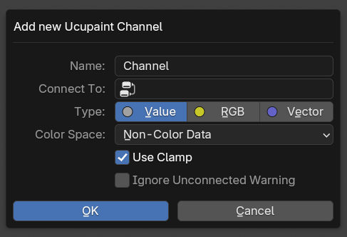|
|:--:|
|New custom channel dialog box | {align=center}

The options when creating a new custom channel are:

- **Name**: Name of the new channel, automatically updated if you change the `Connect To` value to match the selected socket name.
- **Connect To**: Which socket the channel output will connect to. It lists all the unconnected sockets available in the material nodes.
- **Type**: Type of the channel, automatically updated if you change the `Connect To` value to match the selected socket type.
- **Color Space**: Colorspace of the channel, use non-color data if the channel is not used for its color appearance.
- **Use Clamp**: Limit the channel output to a minimum of 0.0 and a maximum of 1.0.
- **Ignore Unconnected Warning**: By default, Ucupaint will give you a warning if the channel doesn't connect to any other socket in the material nodes, this option is to bypass that.
- **Set Strength to One**: Only available on some selected sockets that have a parent strength value (example: Emission Color). Since the default strength is usually zero, this option is to set the value to one.

## Main Channel Types
There are three main channel types in Ucupaint: `RGB`, `Value`, and `Vector`. Color is an example of a `RGB` channel, Metallic, Roughness, and Height are examples of `Value` channels, and Normal is a `Vector` channel.

### Channel Settings
The channel settings for the selected channel can be accessed under the channel list.

|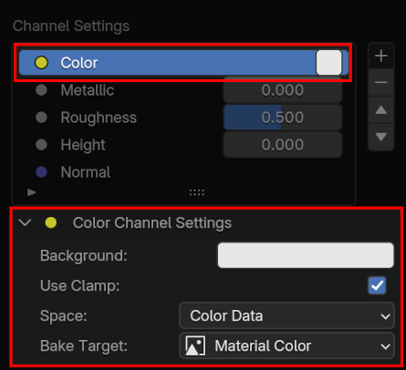|
|:--:|
|Example of RGB channel settings | {align=center}

Here are the options available in the channel settings:

- **Background/Base Value**: The node input value of the channel, it is also accessible in the `Base Layer` and beside the channel name in the channel list.
- **Use Clamp**: Limit the value output of the channel to the 0.0-1.0 range.
- **Space**: Color space of the channel, use `Color Data` for channels that will be used for color, and `Non-Color Data` for channels that will be used for non-color purposes.
- **Bake Target**: The bake target that will be used as the data when baking the Ucupaint node.
- **Special Type**: This option will show up in certain channel, this is to set the channel as a special channel explained in the [Special Channel Types](#special-channel-types) section

## Special Channel Types

There are special channel types in Ucupaint that do more than regular channels. In version 3.0, the special channel types are `Alpha`, `Height`, `Normal` and `Vector Displacement`.

### Alpha channel

Alpha channel needs to be paired with a color channel to work effectively.  Alpha channel also uses special blending that make sure the final color is rendered correctly.

<!--
|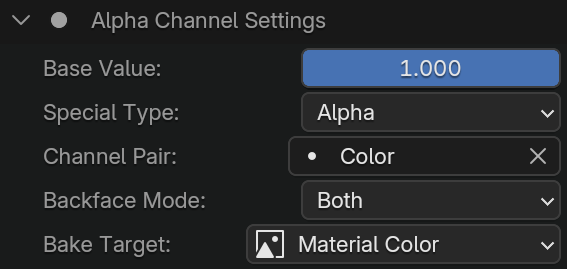|
|:--:|
|Alpha channel settings | {align=center}
-->

Specific settings available in the alpha channel are:

- **Channel Pair**: Links a color channel with the alpha channel. When the color channel is enabled on a layer, the alpha channel is automatically activated as well.
- **Backface Mode**: Option to hide the backface or frontface of the object.

### Normal channel

Normal channel is a special channel that outputs world-space normals of the object surfaces.

<!--
|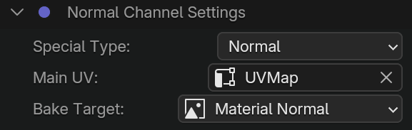|
|:--:|
|Normal channel settings | {align=center}
-->

Specific settings that are available in the alpha channel are:

- **Main UV**: UV Map that will be used for calculating tangents, which are needed for `Overlay` blending mode

### Height channel

<!-- Height channel by default will be used as bump if there's a normal channel and the option `Use Height as Bump` is enabled. -->
Height channel by default will be used as bump if there's a normal channel and the [Displacement Setup](#displacement-setup) isn't enabled yet.

<!--
|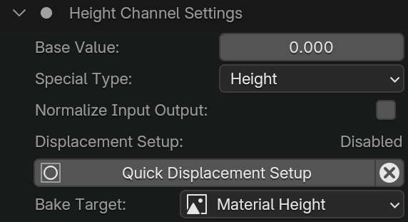|
|:--:|
|Height channel settings | {align=center}
-->

Specific settings that are available in the height channel are:

- **Normalize Input Output**: This will normalize the height channel output to fit in the 0.0-1.0 range. It will also create a midlevel input that can control the midlevel of the height input.
- **Displacement Setup**: Displacement setup is just a status label. If you do the `Quick Displacement Setup`, this will enable the displacement setup, meaning the height output will be accessible and it's automatically connected to the displacement node.

<!-- The button `Quick Displacement Setup` -->

### Vector Displacement channel

Vector displacement channel is similar to the height channel, but rather than just using up and down height, it can use vectors to displace the object's surface

<!--
|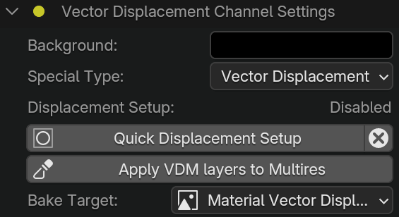|
|:--:|
|Vector Displacement channel settings | {align=center}
-->

Specific settings available in the vector displacement channel are:

- **Displacement Setup**: Similar to height channel, but whether displacement setup is enabled or not, the output of Vector displacement is always accessible. It just indicates that displacement setup has been done before, more details are in the [Displacement Setup](#displacement-setup) section

## Displacement Setup

By default, `Height` channel in Ucupaint is for the bump effect on the normal channel, but it can also work with real displacement, you only need to do displacement setup first. For the `Vector Displacement` channel, it is designed to work with displacement setup enabled, since the channel can work as sculpt layers (**TODO: more info about that is on a different page**)

### Quick Displacement Setup

The ' Quick Displacement Setup ' button is available on both `Height` and `Vector Displacement` channel settings. 

|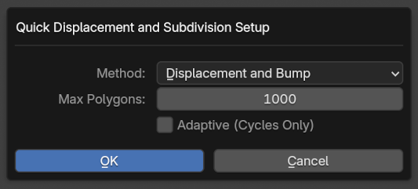|
|:--:|
| Quick Displacement Setup Options | {align=center}

Options that are available for `Quick Displacement Setup`:

- **Method**: To set the displacement method of the current active material.
- **Max Polygons**: Will set the subdivision surface or multires modifier levels based on `Max Polygons` number. The input is in thousands, so 1000 means 1 million polygons.
- **Adaptive (Cycles Only)**: Will enable adaptive subdivision that only works on the Cycles renderer. This can improve displacement details, but will increase load time when entering render view.
- **Dicing Rate**: Will appear if adaptive is enabled. Dicing rate is the number of pixels on screen that will determine mesh subdivision.

Doing displacement setup will also do these things:

- Add a subdivision surface modifier to all objects that share the material if there's no subdivision surface modifier yet.
- Set the subdivision level to reach the `Max Polygons` input. Notice that the input is in **thousands**, so 1000 means 1 million polygons.
- If the object already uses a multires modifier, it will set the levels of the multires modifier instead.
- If the model is detected using flat shading, the subdivision modifier will use the `Simple` type, otherwise it will use `Catmull-Clark` type subdivision.
- Set the displacement method of the material to the chosen method option, the default is `Displacement and Bump` so the height or vector displacement channel can actually displace the surface.
- By default, if there's a height and normal channel, the height channel output is not accessible. Doing a displacement setup will make it available.
- Create a displacement node if there's a height channel exists and connect the output of the height channel to the displacement node.
- Create a vector displacement node if there's a vector displacement channel exists and connect the output of the vector displacement channel to the vector displacement node.
- The displacement and vector displacement node will connect to the active material output, and if there are both of them, an `Add Vector` node will be added.
- All the displacement nodes will only be added if they don't exist yet, so it's safe to do `Quick Displacement Setup` multiple times to set the target polygons

|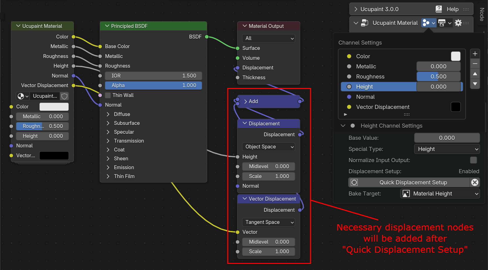|
|:--:|
| Necessary displacement nodes will be created after doing `Quick Displacement Setup` | {align=center}

### Remove Displacement Setup

To remove the displacement setup, there's a button beside the quick displacement setup that has the `X` icon.

|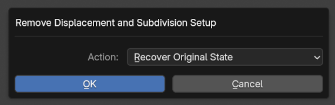|
|:--:|
| Remove Displacement Setup Options | {align=center}

The action input will give you three options:

- **Recover Original State**: This will keep or remove the subdivision modifier based on the first time you did the `Quick Displacement Setup`
- **Remove Subdivision Modifier**: Will remove any subdivision modifiers that exist on all objects that shared the active material.
- **Keep Subdivision Modifier**: Will keep subdivision modifiers, and there's an option to set subdivision level.

Other than doing actions to the subdivision modifiers, removing the displacement setup will also do these things:

- Set the displacement method of the material to `Bump Only` so there will be no displacement on the surface
- If there's a height and normal channel, the height output is no longer accessible

### Displacement Demo

The video below demonstrates displacement setup in action.

||
|:--:|
| Drawing with Displacement| {align=center}

