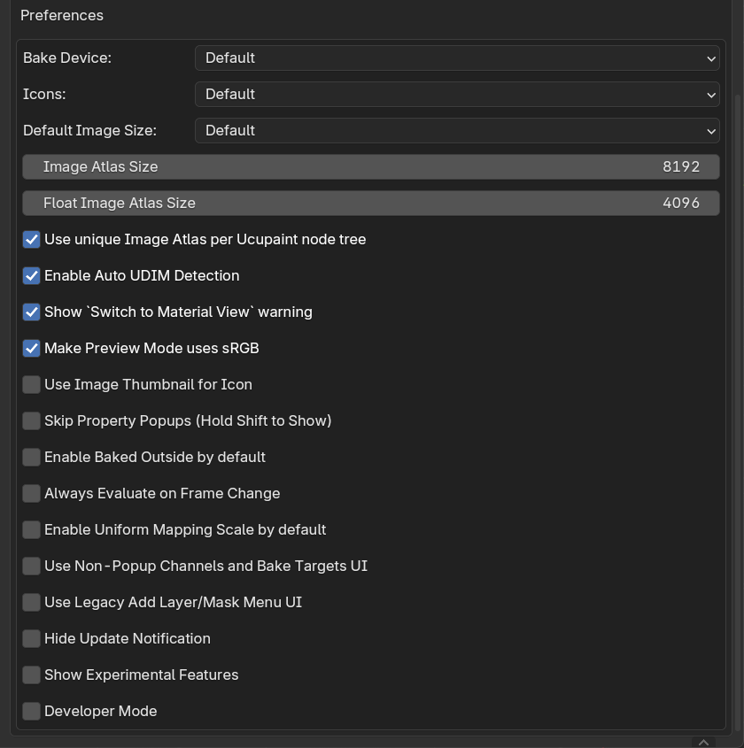

# Preferences

Ucupaint preferences can be accessed in Blender Preferences > Add-ons > Ucupaint

||
|:--:|
| Ucupaint Preferences | {align=center}

Explanations for each preference options:

- **Bake Device**: Default device for baking. The option `Default` meant the last bake device used will be the default for the next bake.
- **Icons**: Ucupaint icons set, you can choose between `Dark`, `Light` or `Legacy`. The `Default` option will change between dark and light icons depending on your active theme.
- **Default Image Size**: Default image device when creating new image. The option `Default` meant the last image size used will be the default for the next time.
- **Image Atlas Size**: Size of the image atlas that will be created.
- **Float Image Atlas Size**: Size of the float image atlas that will be created.
- **Use unique Image Atlas per Ucupaint node tree**: Use unique image atlas per ucupaint node tree rather than every node using the same image atlas.
- **Enable Auto UDIM Detection**: Automatically enable `Use UDIM` based on the selected UV Map when creating/baking an image.
- **Show `Switch to Material View` warning**: Show warning when the view is not in material/rendered view.
- **Make Preview Mode uses SRGB**: Automatically set display viewspace to sRGB when using Preview Mode
- **Use Image Thumbnail for Icon**: Use the image thumbnail for image icon in the layers list.
- **Skip Property Popups (Hold Shift to Show)**: Skip dialog box when creating new image/mask. When enabled, you can bring the dialog box back by holding left shift.
- **Enable Baked Outside by default**: Automatically bring bake target image results to outside of Ucupaint node so exporter can read them.
- **Always Evaluate on Frame Change**: Evaluate all Ucupaint properties on frame change, can be very slow, but needed if you want to keyframe layer/mask visibility toggle. _Tip: If you want to animate layer/mask visibility, you can just keyframe the layer/mask opacity, those don't need this preference option to be enabled._
- **Enable Uniform Mapping Scale by default**: Enable uniform mapping scale by default in Layer and Mask UVs. This will make all scale axes have the same value.
- **Use Non-Popup Channels and Bake Targets UI**: Enabling this will make the channels and bake targets panel accessible below the layers panel. This is the default behavior for Blender 2.7x.
- **Use Legacy Add Layer/Mask Menu UI**: Enabling this will make the add layer/mask menu shows all the options at the same time rather than having submenus. This is default behavior for Blender 3.6 and lower.
- **Hide Update Notification**: Hide update notification even when there's a new version available.
- **Show Experimental Features**: Show Experimental features of Ucupaint, most of features here are incomplete or don't work.
- **Developer Mode**: Do not enable this unless you're a developer and know what you're doing.
